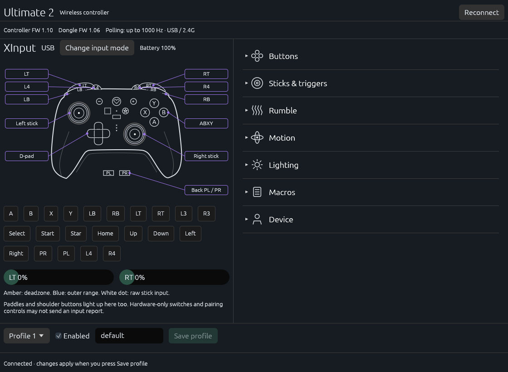
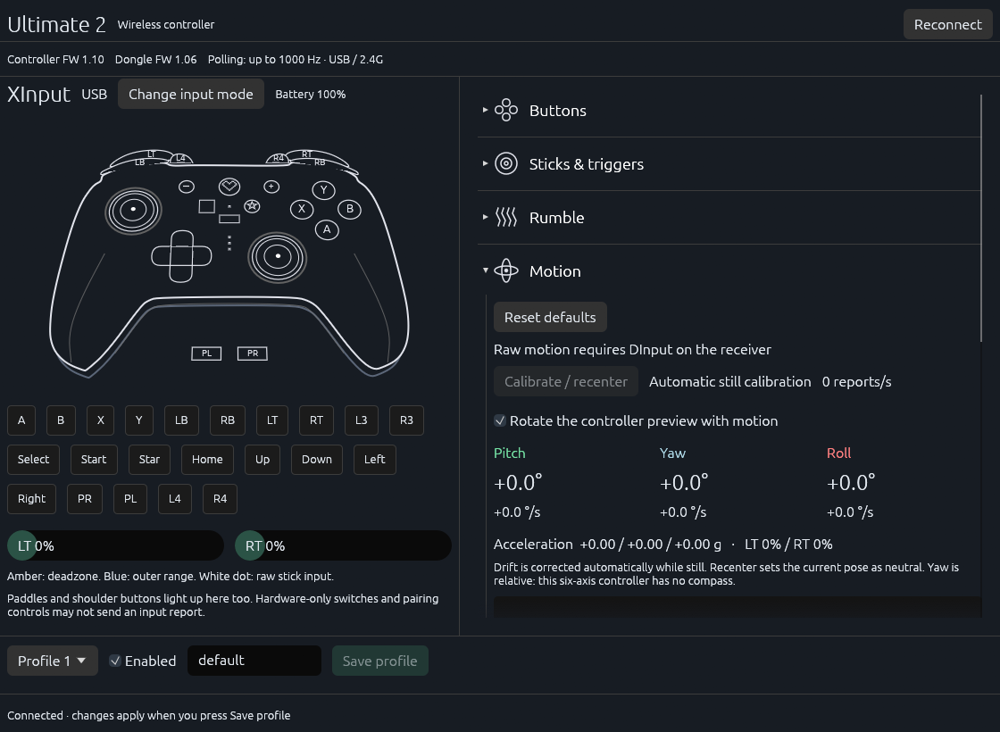
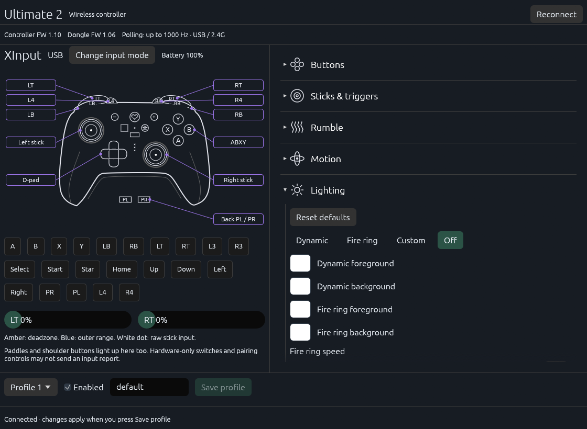
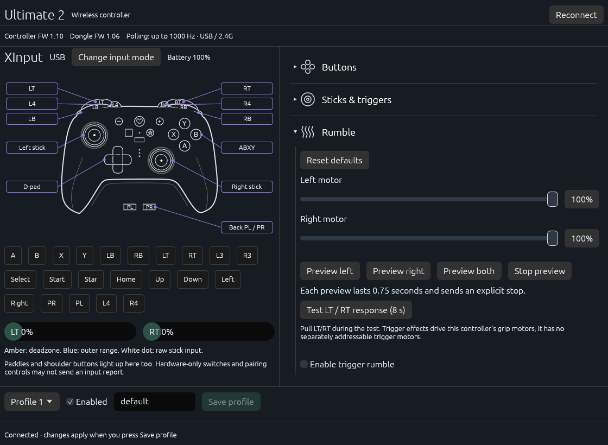
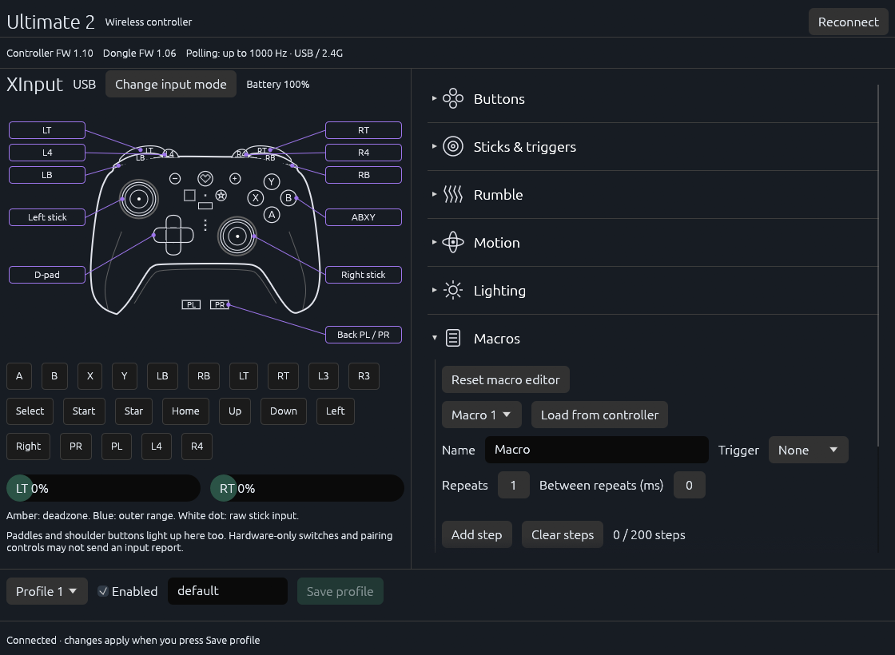

# Ultimate 2 — Native Linux

A **Rust + egui**, native **Wayland** configurator for the **8BitDo Ultimate 2 Wireless**.



| Live motion | Lighting |
| --- | --- |
|  |  |

| Rumble | Macros |
| --- | --- |
|  |  |

- Live USB/wireless inputs, all reported buttons, deadzone circles and collapsible settings.
- Profiles, remapping, stick/trigger ranges, section resets, RGB colours and Off.
- Gyro controller model, automatic still calibration, rumble and LT/RT response previews.
- Macro steps, full backups, pairing guidance, separate controller/dongle firmware tools.
- Both firmware versions on screen; same-version updates are blocked.

## Install

Requires Wayland, Rust 1.95+, a C compiler, pkg-config and Wayland/EGL/xkbcommon development libraries.

```sh
cargo build --release --locked --manifest-path native/Cargo.toml
sh native/install.sh
ultimate2-native
```

Connect USB to edit settings. Wireless modes: power off, then hold **B + Home** for DInput/gyro, **X + Home** for XInput, or **Y + Home** for Switch. The app shows these instructions and detects the actual mode; a working software mode-switch command has not been found. Polling is up to 1000 Hz over USB/2.4G; adjustment is unavailable.

If access is denied, install [the udev rule](udev/70-8bitdo-u2.rules) and reconnect. Settings save explicitly; backups go to `~/.local/share/ultimate2-native/backups/`. [Protocol and test notes](docs/NATIVE_PROTOCOL.md).

**Experimental:** firmware downloads and both bootloader entry/reset paths were checked. Actual firmware flashing and macro writes have not yet been hardware-tested.

## Credits and AI disclaimer

Based on [Miguel Sanz’s original configurator](https://github.com/MiguelSanzBr/8bitdo-ultimate2-linux), including its controller artwork, callouts and section icons. Sensor behaviour follows [SDL’s 8BitDo driver](https://github.com/libsdl-org/SDL/blob/main/src/joystick/hidapi/SDL_hidapi_8bitdo.c). Original MIT credits are preserved; the legacy Python/web sources remain available.

**Developed with AI assistance.** This unofficial fork is not affiliated with 8BitDo. No proprietary application code or assets are redistributed.
